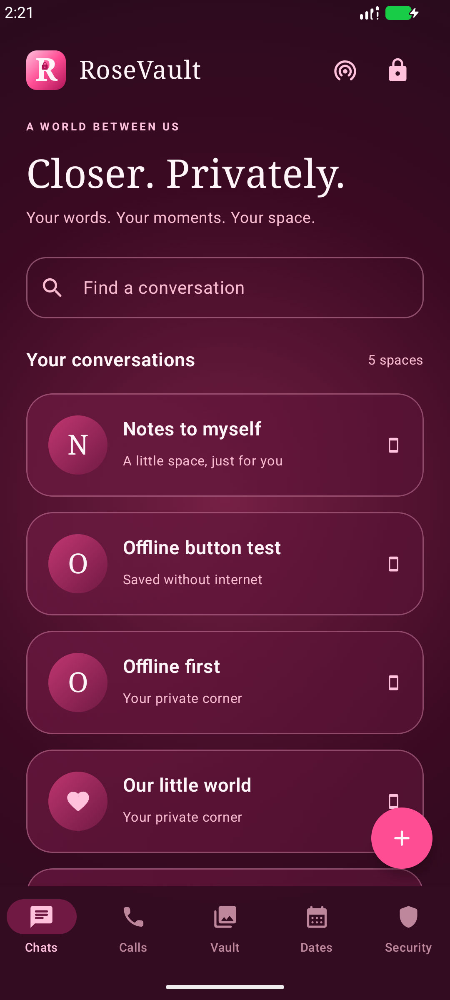

# RoseVault

An experimental native Android vault and messenger, released under the **MIT license**. Kotlin, Jetpack Compose, Android Keystore, Supabase, WebRTC, and Nearby Connections. Android 12+.



## What works locally

- Encrypted local spaces, saved messages, media import/open/delete, calendar, and an encrypted persistent outbox.
- Phone screen-lock/strong-biometric entry, optional separate RoseVault password, inactivity/background locking, and screenshot protection.
- Nearby text and attachment exchange with code comparison, pinned identities, acknowledgements, deduplication, and reconnect queues. Both apps must be open and unlocked, with Bluetooth/Wi-Fi and Google Play services available.

## Supabase backend

The Android cloud client uses Supabase Auth phone OTP, a protected PostgreSQL schema, and a private Storage bucket. It supports opt-in number lookup, pinned two-person conversations, encrypted messages/calendar data, and foreground WebRTC call signaling. The app contains no Firebase SDK or Firebase account configuration.

**This is an early reference implementation, not an independently audited production secure messenger.** Device keys use static P-256 ECDH and safety numbers; a reviewed ratcheting protocol, forward secrecy, multi-device fan-out, key backup and recovery are not implemented. Compare safety numbers before sensitive conversations. See [SECURITY.md](SECURITY.md).

Cloud messaging polls while unlocked (approximately every five seconds; call signaling every two seconds). It does not provide background push or guaranteed ringing while closed. Phone OTP needs an SMS provider configured in your own Supabase project. Live calls require your own TURN relay and server-side secrets. Neither SMS nor calling is automatically free because the source is open.

## Build and run

1. Install JDK 21 and Android SDK platform/build tools 36.
2. For an offline build: `./gradlew -PenableCloud=false :app:assembleDebug`.
3. For cloud mode: deploy your own backend using [SETUP.md](SETUP.md), copy `supabase.properties.example` to `supabase.properties`, enter your HTTPS project URL and **publishable** key, then run `./gradlew -PenableCloud=true :app:assembleDebug`.
4. Install the APK from `app/build/outputs/apk/debug/`. Keep your existing vault installed when updating with the same signing key. Uninstalling/clearing data destroys local hardware keys; phone login cannot recover them.

A clone generates its own debug signing key and cannot update an APK signed by another developer. Use a separate test installation/application ID instead of uninstalling a valuable vault. Public distribution needs a maintained release-signing process; do not commit signing keys.

## Verify

```sh
./gradlew -PenableCloud=false :app:testDebugUnitTest :app:lintDebug
npm ci
npm test
# With Docker running:
npm run backend:start
npm run test:rls
```

Native device tests are under `app/src/androidTest`. [VALIDATION.md](VALIDATION.md) distinguishes actual checks from remaining real-device/service tests. GitHub Actions builds offline and checks the local backend without project credentials.

## Documentation

- [SETUP.md](SETUP.md): deploy your own Supabase project, phone provider and private media.
- [REMOTE_CALLS_SETUP.md](REMOTE_CALLS_SETUP.md): TURN and calls between different networks.
- [APP_PASSWORD.md](APP_PASSWORD.md): password use, owner recovery and limits.
- [OFFLINE.md](OFFLINE.md): Nearby pairing and offline queues.
- [CONTRIBUTING.md](CONTRIBUTING.md), [THIRD_PARTY_NOTICES.md](THIRD_PARTY_NOTICES.md), [LICENSE](LICENSE).

The MIT license applies to RoseVault's original source. Third-party components keep their own licenses. Nearby still requires Google Play services; using Supabase does not remove that dependency.
